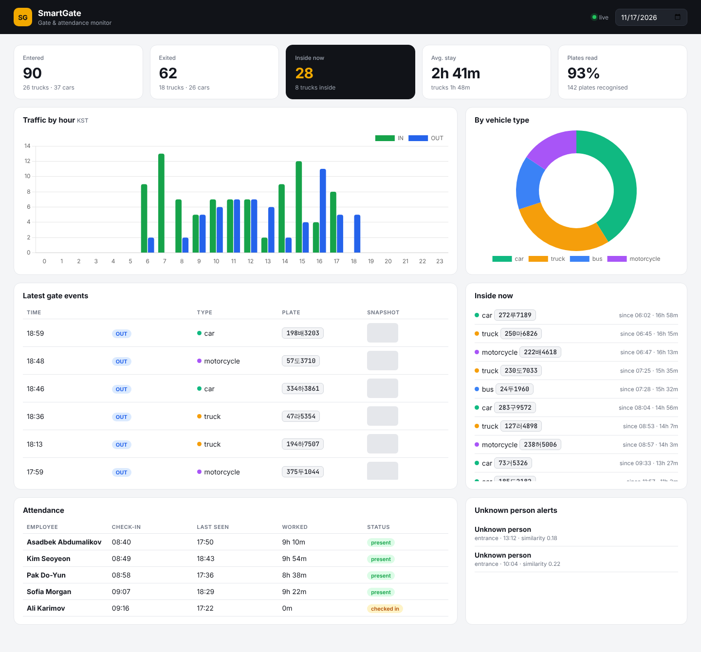

# SmartGate 🚧

**AI gate and attendance monitor for warehouses, factories and offices.**
A camera at the gate counts every vehicle that enters and leaves, tells cars
from trucks, reads Korean licence plates and measures how long each vehicle
stayed inside. A camera at the entrance recognises employees for attendance
and raises an alert when an unknown person walks in. Everything appears live
on a web dashboard.

> Built after seeing, during an internship, how a kindergarten struggled with
> manual attendance, staff hours and strangers at the door — and how many
> warehouses still keep their gate log on paper.


*Dashboard with demo data from `python -m smartgate.simulate`.*

## What it does
| | |
|---|---|
| 🚗 **Vehicle counting** | YOLO11 detects cars, trucks, buses and motorcycles; ByteTrack follows each one; a virtual line decides IN or OUT. Each vehicle is counted once. |
| 🔢 **Plate reading** | The plate rectangle is located by colour and shape, cropped tight and read by EasyOCR restricted to plate characters. Only valid Korean formats (`12가3456`, `서울12가3456`) count as a full plate; when the Hangul letter is unreadable the last 4 digits are kept as a fallback key. Reads from several frames are combined by voting. |
| ⏱️ **Dwell time** | An OUT event is matched to its IN by full plate, then by last 4 digits, so the dashboard shows how long each truck stayed and who is inside right now. |
| 🙂 **Face attendance** | InsightFace (RetinaFace + ArcFace) recognises enrolled employees; first and last sighting of the day give check-in, check-out and hours worked. |
| 🚨 **Unknown person alerts** | A face that stays unrecognised for several frames triggers an alert with a snapshot. |
| 📊 **Live dashboard** | KPIs, traffic by hour, vehicle types, latest events with plates and snapshots, attendance and alerts — updated over WebSocket. |

## Architecture
```
 gate camera ─┐                                      ┌─► MongoDB
              ├─► Python AI worker ── HTTP + key ──► NestJS API ──┤
 door camera ─┘   YOLO11 · ByteTrack · EasyOCR        │           └─► uploads/ (snapshots)
                  InsightFace · offline queue         └─► WebSocket ─► dashboard
```
* **worker/** (Python) — all computer vision runs locally on the edge machine; only small JSON events and thumbnails leave it. If the API is down, events are queued to disk and re-sent later.
* **api/** (NestJS + Mongoose) — validates events, pairs IN/OUT visits, stores attendance, computes stats in Korea time, pushes updates over Socket.IO and serves the dashboard.

### Models
| Task | Model | Notes |
|---|---|---|
| Vehicle detection | YOLO11n (COCO pretrained) | classes car, motorcycle, bus, truck — no extra training needed |
| Tracking | ByteTrack | built into Ultralytics |
| Plate localisation | OpenCV colour + shape rules | yellow / white / green rectangles, aspect ratio 1.8–6.5 |
| Plate OCR | EasyOCR (Korean, plate-character allowlist) | format check, last-4-digit fallback, per-vehicle voting |
| Face detection + recognition | InsightFace `buffalo_l` (RetinaFace + ArcFace) | 512-d embeddings, cosine similarity ≥ 0.45 |

## Privacy by design
* Employees are created with **explicit consent**; the API refuses enrolment without it.
* Only a **512-number embedding** is stored per person — enrolment photos never leave the worker machine.
* `DELETE /api/employees/:id/face` removes the biometric template (right to be forgotten) while keeping attendance history.
* The embeddings endpoint and every write endpoint require the worker API key.

## Quick start

### 1. API + dashboard
Requirements: Node 20+, MongoDB 7 (local install or `docker compose up -d`).
```bash
cd api
cp .env.example .env          # set WORKER_API_KEY to a long random string
npm install
npm run start:dev             # http://localhost:3000
```

### 2. AI worker
Requirements: **Python 3.10–3.12**.
```bash
cd worker
python -m venv .venv
source .venv/bin/activate     # Windows: .venv\Scripts\activate
pip install -r requirements.txt
cp .env.example .env          # same key as the API
```

### 3. See it working without cameras
```bash
python -m smartgate.simulate          # fills today's dashboard with realistic demo events
```

### 4. Count vehicles in a video
```bash
python -m smartgate.run_gate --source videos/gate.mp4 --pick-line --save out.mp4
```
Click two points to draw the gate line (the command prints them as `--line x1,y1,x2,y2` for next time).
Add `--flip` if IN and OUT are reversed, `--show` for a live window, `--dry-run --csv run.csv` to test without the API.
An RTSP url or a webcam index works as `--source` too.

### 5. Face attendance
```bash
# create the employee (consent is required)
curl -X POST localhost:3000/api/employees -H "x-api-key: <key>" -H "content-type: application/json" \
     -d '{"name":"Asadbek","department":"IT","consent":true}'
# enrol from 3-5 photos, then start the entrance camera
python -m smartgate.enroll --employee <id> --images photos/asadbek/
python -m smartgate.run_faces --source 0
```

### Plate reading - known limit
On distant, low-resolution footage (plate ≈ 30 px tall) the digits are read but the Hangul letter usually is not, so only the last 4 digits are stored (`··2641` on the dashboard). A real gate camera 3–5 m from slow vehicles gives much larger plates; a model trained on Korean plates would be the next step. `--plate-debug DIR` saves every plate crop with the raw OCR text for tuning.

## Measuring accuracy
Count the vehicles in each test video by hand once (`eval/truth.json`), run the gate with `--dry-run --csv eval/<video>.csv`, then:
```bash
python -m smartgate.eval_count --truth eval/truth.json --runs eval/
```
It prints per-video and overall counting accuracy. The FPS is printed at the end of every `run_gate` run.

## API
| Method | Path | Auth | Purpose |
|---|---|---|---|
| POST | `/api/vehicle-events` | key | gate crossing from the worker |
| GET | `/api/stats/vehicles?date=YYYY-MM-DD` | – | KPIs, hourly traffic, dwell time, plate read rate |
| GET | `/api/vehicle-events?limit=` | – | latest events |
| GET | `/api/vehicles/inside` | – | vehicles inside now |
| POST | `/api/employees` | key | create employee (`consent: true` required) |
| GET | `/api/employees` | – | employees without biometrics |
| GET | `/api/employees/embeddings` | key | templates for the worker |
| POST / DELETE | `/api/employees/:id/face` | key | enrol / delete face template |
| POST | `/api/face-events` | key | recognised or unknown face |
| GET | `/api/attendance?date=` | – | check-in, last seen, hours, late flag |
| GET | `/api/alerts` | – | unknown-person alerts |

## Tests
```bash
cd worker && pytest -q        # line crossing, plate formats & voting, face matching, offline queue, eval
cd api && npm test            # visit pairing, stats in KST, attendance, API-key guard, validation
```
Neither suite needs a camera, a GPU or MongoDB.

## Licences
YOLO11 / Ultralytics is AGPL-3.0 and the InsightFace pretrained models are for non-commercial research.
Both are fine for this open-source portfolio project; a commercial deployment would need the respective commercial licences.
